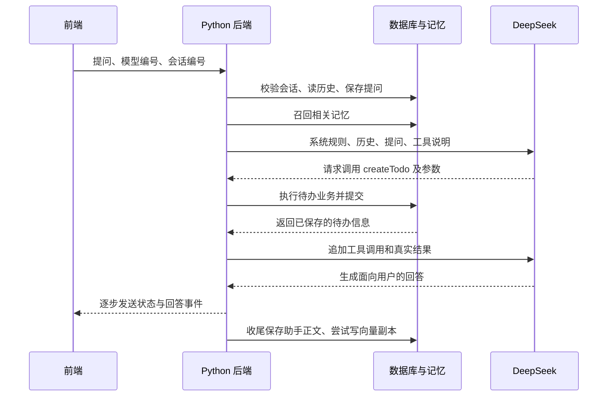

# Python 后端入门：从一次聊天读懂 swag_agent

这份文档面向已经接触过编程、但还不熟悉 Python 的你。内容以当前仓库源码为准。文中的请求、模型输出和工具结果都是讲解示例，不表示执行过这些操作。

你可以先记住一句话：**这个后端把“能聊天的模型”和“能操作数据的程序”接在一起，让你通过一句话管理待办、网站和笔记。**

可以把整个系统想成一个办公室：前端是你使用的办事窗口，后端是办公室里的工作人员，模型是负责理解需求和组织回答的助理，工具是实际办事的程序，数据库和磁盘是资料柜。

助理说“我已经添加待办”，不意味着资料柜里真的多了一条记录。只有后端调用创建待办的函数，并成功提交数据库，事情才真正办成。读这个项目时，要一直分清“模型说了什么”和“程序做了什么”。

## 1. 先认清仓库里这三个项目

| 目录 | 负责什么 | 使用的技术 |
| --- | --- | --- |
| `swag_agent_web/` | 页面、输入框、消息展示、待办和笔记界面 | Vue 3 + Vite |
| `swag_agent_backend/` | 原来的后端实现 | Java + Spring Boot + Spring AI |
| `swag_agent_backend_py/` | 这次补注释、需要学习的后端 | Python + FastAPI |

Java 与 Python 是两份后端实现，不是每次请求都先过 Java 再过 Python。前端请求会到代理配置选中的那个服务。Python 版沿用大量原接口地址、JSON 字段和数据库结构，因此源码里经常出现“与 Java 对齐”。意思是：后端内部换了语言，前端仍能按原约定发请求和读结果。

当前仓库的 `swag_agent_web/vite.config.js` 把 `/api` 请求转给 `http://localhost:8081`，并去掉 `/api` 前缀。例如：

```text
浏览器请求：/api/test/chat/stream/events?...
                    ↓ Vite 开发代理去掉 /api
Python 收到：/test/chat/stream/events?...
```

这里说明的是当前文件配置，不能据此判断你的电脑上哪个服务正在运行。生产环境的转发还要看部署配置。

## 2. 这些框架和库各自做什么

“框架”可以理解为已经搭好的工作场地：它处理许多重复劳动，你在指定的位置填入业务代码。“库”是你按需调用的现成工具。在这个项目里，不必先纠结二者的严格边界，先记各自职责。

| 名字 | 在项目里的任务 | 日常类比 |
| --- | --- | --- |
| Uvicorn | 监听端口，接收网络请求，把请求交给应用 | 打开办公室的大门和电话线路 |
| FastAPI | 根据地址找到处理函数，安排参数解析、依赖和响应 | 按事项把人分到不同窗口 |
| Pydantic / pydantic-settings | 解析请求字段和配置项，检查声明的类型 | 核对表单格式、读取工作设置 |
| SQLAlchemy | 将 Python 对象与数据库表对应，组织查询和事务 | 用统一规则查找、填写资料柜 |
| OpenAI SDK | 按兼容协议向配置中的 DeepSeek 地址发模型请求 | 给外部助理打电话 |
| httpx | 调用 Tavily、Ollama 等 HTTP 服务 | 联系其他外部服务的通用电话 |
| PostgreSQL + pgvector | 保存和搜索文本对应的向量 | 按含义找资料的检索柜 |
| BCrypt | 生成和验证密码哈希 | 保存可核验的密码指纹 |
| APScheduler | 按时间运行后台任务 | 定时闹钟 |
| pytest | 运行自动化测试 | 检查各办事流程的练习题 |

依赖清单在 [pyproject.toml](../pyproject.toml)。这里没有用 LangChain 或 LangGraph 来执行聊天主循环；当前流程由自己的 `runner.py`、`stream/bridge.py` 和工具注册表组织。

SDK 名叫 OpenAI，不代表这份代码默认调用 OpenAI 的模型。实际服务地址由 `deepseek_base_url` 指定，客户端代码见 [agent/llm.py](../app/agent/llm.py)。

## 3. 目录为什么这样分

```text
app/
├── main.py             服务装配入口
├── config.py           配置项和默认值
├── bootstrap.py        启动时补齐注册设置、管理员
├── api/                HTTP 入口：接参数、取身份、返回结果
├── core/               共用规则：错误、鉴权、密码、时间
├── db/                 数据库连接和表的 Python 映射
├── domains/            具体业务：认证、会话、待办、网站、笔记
├── agent/              模型调用、消息组装、工具循环、流式事件
├── memory/             最近历史、会话语义记忆、用户事实
├── skills/             读取、启停、安装技能文字指南
├── audit/              记录执行过程、查询审计、管理确认票据
└── jobs/               定时结算、回收站清理
```

最常见的业务分工是：

```text
api 接请求 → service 判断怎么做 → repository 访问数据库
                                     ↓
                              models 描述表结构
```

以待办为例：

- [api/todo.py](../app/api/todo.py) 接收标题、日期等字段，拿到当前用户。
- [domains/todo/service.py](../app/domains/todo/service.py) 判断标题能否为空、延期日期是否合理，以及要更新哪些统计。
- [domains/todo/repository.py](../app/domains/todo/repository.py) 实际查询或修改待办表。
- [domains/todo/views.py](../app/domains/todo/views.py) 整理前端需要的字段和时间格式。
- [db/models.py](../app/db/models.py) 说明 `TodoItem` 对应哪张表、有哪些列。

这样分工是为了让规则集中。例如，页面按钮和模型工具都能调用同一个待办 service，避免两边各写一套“什么日期允许延期”的规则。

不过，**不要以为每个目录都严格套用了同一种层次**。认证服务直接使用 SQLAlchemy；笔记服务主要读写磁盘；`api/chat.py` 虽在 api 目录下，实际上负责聊天响应组装，真正挂地址的是 `api/legacy_chat.py`。

## 4. 服务启动时发生了什么

开发入口是 [run_dev.py](../run_dev.py)，也可以从 Python 后端目录启动：

```bash
.venv/bin/python run_dev.py
```

这里的 `.venv` 是这个项目单独使用的 Python 环境，里面装着本项目依赖，避免与其他项目互相影响。`pyproject.toml` 声明 Python 至少为 3.12。

`run_dev.py` 把 `app.main:app` 交给 Uvicorn：

```text
app.main   → app 目录里的 main.py 模块
:app       → 这个模块里名为 app 的应用对象
```

[main.py](../app/main.py) 中的 `create_app()` 负责装配：创建 FastAPI 应用，安装统一错误处理，挂上鉴权和审计中间件，再逐个导入路由模块。

“中间件”是请求进入业务函数前后会经过的公共处理程序。像办公室门口的身份检查，以及办事过程的登记人员。

`lifespan()` 是整个服务的开关机流程。启动时按配置开启定时器、补齐初始数据；停止时关闭定时器。它不是每次聊天都运行一次。

`bootstrap.py` 会在业务表已存在的前提下，补齐注册配置，并按配置补建或提升管理员。**它不负责创建全部业务表。**

配置来自 [config.py](../app/config.py) 的 `Settings`。大体优先级为环境变量、`.env`、代码默认值。比如 `MYSQL_HOST` 对应 `mysql_host`。`.env` 相对于启动工作目录查找，因此要从 `swag_agent_backend_py` 目录启动。

## 5. 先看一条不经过 AI 的请求

假设你点击待办面板的“完成”按钮，发出 `PATCH /api/todo/12/complete`：

1. Vite 去掉 `/api`，把请求转给 Python。
2. 鉴权中间件提取登录令牌，检查数据库中的令牌是否有效。
3. 审计中间件建立本次请求的审计编号并记录请求事件。
4. FastAPI 找到 `api/todo.py` 的 `complete()`。
5. `Depends(current_user)` 提供当前用户，`Depends(get_db)` 提供数据库会话。
6. `domains/todo/service.py` 检查这条待办是否属于当前用户，标成 DONE，并更新统计。
7. 数据库事务提交，接口返回更新后的待办字段。

这个过程不需要调用模型。页面上的常规增删改查，通过普通接口就能完成。

“请求”和“响应”可以理解为一问一答：浏览器发地址、方法、请求头和参数，后端返回状态码、响应头和数据。HTTP 的 GET、POST、PATCH、DELETE 是请求方法；它们具体做什么仍由代码决定。

## 6. 一句话如何变成真正的操作

现在你在聊天框说：“帮我添加一个明天下午三点开会的待办。”前端的实际入口在 [src/api/chat.js](../../swag_agent_web/src/api/chat.js)：

```text
GET /api/test/chat/stream/events
    ?model=1
    &userInput=帮我添加一个明天下午三点开会的待办
    &conversationId=42
```

前提是会话 `42` 已经创建，并且属于当前登录用户。后端不会因为你随便填了一个会话编号，就允许访问别人的聊天。



图中的模型决定调用工具只是一种可能路径。普通问答可能直接生成回答，不执行工具。文字和状态会在处理过程中逐步发给前端，图中把它们合并画出以便阅读。

**第一步，进入聊天路由。** [api/legacy_chat.py](../app/api/legacy_chat.py) 的 `chat_stream_events()` 接收查询参数，使用线程池执行准备工作，再返回流式响应。`legacy` 是兼容旧地址的命名，不表示这个接口已经不用；前端当前使用的正是它。

**第二步，准备一轮对话。** [agent/runner.py](../app/agent/runner.py) 的 `prepare_turn()` 校验会话归属、选择模型、先读取旧历史，再写本次提问。读取历史一定放在保存本次提问之前，否则当前问题可能出现在“历史”和“当前提问”里各一次。

有会话时，用户提问先保存；即使后面模型失败，你的这条输入仍有记录。没有传 `conversationId` 时，不会自动在这里创建会话或保存展示历史，不过其他按用户取得的背景信息仍可能存在。

**第三步，整理模型要看的材料。** `build_messages()` 把下面的内容组起来：

```python
[
    {"role": "system", "content": "助手规则、技能指南、相关记忆……"},
    {"role": "user", "content": "上一条问题"},
    {"role": "assistant", "content": "上一条回答"},
    {"role": "user", "content": "本次问题"},
]
```

这只是消息形状的示例。`system` 是规则与背景，`user` 是用户文字，`assistant` 是助手文字。工具说明则单独放在模型请求的 `tools` 参数里。

**第四步，请模型判断。** [agent/llm.py](../app/agent/llm.py) 发出请求。模型看到 `createTodo` 的名称、用途、参数格式后，可能返回：

```json
{
  "name": "createTodo",
  "arguments": {
    "title": "开会",
    "note": "",
    "dueDate": "明天",
    "dueTime": "15:00"
  }
}
```

这是工具调用的概念示例，真实 SDK 数据还有调用编号、索引和外层结构。模型也可能选择不同的措辞和参数。

**第五步，Python 执行工具。** [agent/stream/bridge.py](../app/agent/stream/bridge.py) 收齐调用参数，通过 `dispatch()` 找到 [domains/todo/tools.py](../app/domains/todo/tools.py) 的 `create_todo()`。工具再调用待办 service，后者写数据库并提交。

用户编号来自后端的 `ToolCtx`，并非让模型填写。这样模型要操作的是当前登录用户的数据。

**第六步，把工具结果交回模型。** 比如工具返回“已记录待办 #12 开会”。后端会把工具调用请求以及 `role=tool` 的结果追加到消息列表，再请求模型。模型根据真实结果组织回答。

这就是这里的 **Agent 工具循环**：模型判断 → 程序执行 → 模型看结果 → 继续判断或回答。项目默认最多进行 8 轮模型请求，可通过配置覆盖；一轮可能包含多个工具调用，代码按索引顺序执行。达到上限后按已有状态收尾，不会无限循环。

**第七步，保存回答。** `api/chat.py` 的流式生成器在 `finally` 中调用收尾，使用独立数据库会话保存当前累积的助手正文、刷新会话时间，并尝试写入语义记忆副本。正常结束、错误或客户端中断都会尝试收尾；保存失败会记日志，不能承诺任何环境下都必定保存成功。

## 7. 工具是怎样被模型“看见”的

工具有两面：一面是模型阅读的说明，一面是后端执行的函数。

```python
@tool(
    name="createTodo",
    description="新增一条待办……",
    parameters={...},
    side_effect="write",
)
async def create_todo(title, note, dueDate, dueTime, ctx):
    ...
```

这是缩写示意，实际代码保留了完整参数结构和类型。

`@tool(...)` 会把函数登记到 `REGISTRY` 中。登记发生在工具模块被导入时，而不是直接执行待办创建。可以把注册表想成“工具名 → 真正函数”的通讯录。

`openai_tools()` 将名称、说明和参数结构交给模型；`dispatch()` 则查通讯录、解析 JSON、检查必填参数、注入可信上下文，最后执行函数。模型不会拿到数据库连接，也不会直接在远端运行这些 Python 函数。

还有一个容易误读的细节：工具函数返回“未找到待办”这类业务提示时，调用本身可能仍被标为 SUCCEEDED，因为函数正常返回了文字；未知工具、参数缺失、函数抛错等才由分发器标为 FAILED。**工具状态成功，不一定代表你希望的业务结果成功，还要看返回内容。**

## 8. 为什么回答能一段一段出现

后端不用等全文完成才返回，而是保持一个 HTTP 响应打开，持续发送小段事件。这里使用 SSE，可以理解为一条持续送来消息的传送带。

事件编码在 [agent/stream/events.py](../app/agent/stream/events.py)：

```text
event: content
data: {"text":"已添加"}

event: content
data: {"text":"明天的待办。"}

```

每条事件最后有一个空行。网络传来的一个数据块，可能只包含半条事件，也可能包含多条。前端因此先放进缓冲区，遇到空行才解析完整事件。这里用的是带登录请求头的 `fetch` 读取响应流。

| 事件名 | 给前端的含义 |
| --- | --- |
| `ready` | 对话流已进入处理，携带会话编号 |
| `content` | 正文文字片段，收尾时也可能发送一段完整正文 |
| `reasoning` | 工具事件之后的过程文字 |
| `tool_call` | 工具开始、成功或失败，以及提示和耗时 |
| `segment_boundary` | 调整过程区与最终正文区的分界 |
| `error` | 本轮出错；当前实现随后结束，不再发送 done |
| `done` | 流正常结束 |

一轮不会必然发送全部七种事件。模型没有调用工具时，一般就是 ready、正文和 done。

尤其要区分两个相似名字：**前端的 `reasoning` 事件，是代码分类出来的过程文字；模型原始 `reasoning_content` 在当前实现中只供后续工具轮次回传给模型，不直接推送成该事件。**

工具调用前的“我先查一下”可能已经先作为正文发出。后端收尾时会通知前端调整分区，并把工具后的累计文字转成最终正文。不能简单地把所有 `content` 和 `reasoning` 盲目拼接，否则可能出现重复文字或把铺垫当答案。

这套状态与事件转换，就是 `bridge.py` 的职责：它把模型的原始数据流翻译成你的聊天界面能够展示的事件。

## 9. 三种记忆分别记什么

“记忆”在这里就是后端保存、检索，然后重新放进模型请求的文字。它不会修改模型本身的参数，也不是模型直接记住了数据库。

| 记忆 | 生活类比 | 从哪里读 | 主要范围 |
| --- | --- | --- | --- |
| 最近对话历史 | 桌面上最近翻过的聊天页 | MySQL `chat_message` 最近最多 40 条消息 | 当前会话 |
| 会话语义记忆 | 从旧聊天里按含义找相关片段 | PG `vector_store`，配合 Ollama 生成向量 | 当前记忆键 |
| 用户长期事实 | 写着你的偏好和习惯的小卡片 | MySQL `chat_user_memory`，PG 存向量副本 | 当前用户，可跨会话 |

40 条指消息条数，不是 40 组问答。普通一问一答占两条。最近历史先按编号倒序取最新部分，再倒回来交给模型阅读。

“向量”可以先理解成一段代表文本含义的数字。Ollama 的嵌入模型把问题和历史文字变成数字，pgvector 根据这些数字之间的距离找含义接近的片段。就像找“关于会议”的资料，不必只匹配文字里有没有一模一样的“会议”二字。语义检索也会有误差，不代表一定找到正确记忆。

当前默认嵌入模型配置是 `nomic-embed-text`，库结构按 768 维设计。更换嵌入模型不是只改聊天模型名，需要考虑向量维度和已有数据重建。

两类向量记忆的故障处理不同：

- 会话语义检索失败时跳过这部分背景，继续聊天。
- 用户事实语义检索失败或没有结果时，从 MySQL 取最近几条事实作为补充。

“记住我每周五下午开会”会走 `rememberUserMemory` 工具。它先保存 MySQL 文本，再尝试写向量副本。MySQL 和 PG 是两个数据库，没有覆盖两者的统一事务，所以向量失败时文本仍可保存成功。

用户长期记忆开关控制用户事实的保存和召回，不代表关闭所有聊天历史或会话语义记忆。关闭时也不删除已保存的事实。

会话语义记忆通常使用会话编号作为记忆键；没有会话编号时退回用户编号字符串。这是当前实现的键规则，不应把它理解为所有用户的所有会话共用一份长期历史。

删除聊天消息后，后端从剩余消息重建记忆副本，避免模型继续读取本应已删除的片段。向量库不可用时清理也可能失败，因此“源记录删除”和“所有副本同步清理成功”不是同一件事。

## 10. Skill 和 Tool 有什么区别

**Skill 是文字说明，Tool 是可执行的函数。**

比如，一个“周报写作”技能可以解释周报要分哪几个部分；一个“保存笔记”工具才负责真正把文字写入文件。

项目的技能系统会扫描内置目录和外部 `skills-data/`，读取每个技能的 `SKILL.md`，解析名称、简介和正文。管理员可以安装、刷新、启用或禁用。启停状态存在 `skill_state` 表里，是全局设置。

组装提示词时，[skills/assembler.py](../app/skills/assembler.py) 把启用技能的正文追加进去。当前实现是把启用项一起加入，并对每个技能正文分别限制长度；不是让一个路由模型自动挑选唯一技能，也没有为 SKILL.md 自动生成新 Python 工具。

更改外部根目录的修改时间会触发下次读取重扫；如果只修改某个文件内部正文，显式调用刷新更可靠，不能假定任何文件内容变化都会立即被发现。

## 11. 业务数据到底存在哪里

MySQL 是主要业务记录的存储位置：账户、登录令牌、会话、消息、用户事实、待办、网站分类和书签、技能启停、审计及确认票据。

PG 保存两类向量数据，用来做语义检索。它不是这些 MySQL 业务表的完整复制。

笔记主要存放在磁盘的 `notes-data/user-<用户编号>/`，不是把 Markdown 正文放进 MySQL：

```text
notes-data/user-1/
├── 未分类/       默认笔记目录
├── 学习笔记/     你创建的分类
├── .trash/       删除后暂存的文件和恢复信息
└── .resources/   导入时复制的附件
```

笔记服务检查相对路径和真实路径，拒绝通过 `..` 或符号链接访问用户目录外的文件。“本地路径导入”读取的是**运行后端那台机器**的文件，且必须处于配置允许的目录；浏览器用户电脑上的文件要通过上传导入。

导入还会复制引用附件、改写链接，并汇总每个来源的成功、失败和警告。一个文件失败不会把整批已经成功的文件撤销。

常用网站也是独立业务：分类组成树，书签属于分类。分类节点的数量包含子树，但按分类筛选的列表只查直属分类。修改网站地址或图标地址会清掉旧图标缓存，下次读取时再尝试抓取。

待办则把条目、延期流水和日统计分开保存。完成、延期、删除都可能影响统计，所以这些规则集中在待办 service，而不是散落在页面入口和聊天工具里。

## 12. 数据库 Session 和事务怎么理解

先区分三个词：

- `engine`：连接池，管理一组可以复用的数据库连接。
- `SessionLocal`：创建数据库会话的工厂，调用它才得到会话。
- `db` / `Session`：一次具体的查询和修改工作上下文，不是聊天会话。

`ChatConversation` 才是用户看到的聊天会话。不要因为两个概念都叫“会话”而混淆。

下面是用于理解调用方式的例子，不需要执行：

```python
item = TodoItem(title="开会", user_id=user_id, ...)
db.add(item)       # 告诉 SQLAlchemy：准备保存这个对象
db.flush()         # 把变动发给数据库，可能取得自增编号；事务还没正式提交
db.commit()        # 正式提交事务
```

`rollback()` 撤销未提交事务，`close()` 结束会话并释放资源，`refresh()` 从数据库重新读取对象。**flush 不等于 commit，close 也不会自动帮你提交。**

待办和网站 repository 多数只 flush，让 service 把条目修改和相关统计统一提交。会话 repository 的一些函数则直接 commit。因此读代码要看具体函数，不能假定所有 repository 都不提交。

一次聊天也不是一个从头到尾的大事务：用户提问先保存，模型运行，助手正文再另行保存，向量副本随后尽力更新。这种安排允许你在模型失败时仍保留已经提交的提问。

## 13. 登录和审计在保护、记录什么

登录时，[domains/auth/service.py](../app/domains/auth/service.py) 校验 BCrypt 哈希，然后生成随机 UUID 令牌，保存到 `auth_token` 并记录有效期。这个令牌不是 JWT，不靠在字符串里解码出用户身份；每次检查时会查询数据库。

前端把令牌放进 `Authorization: Bearer <token>`。鉴权中间件验证成功后，把真实用户编号和角色写进 `request.state`，接口再通过依赖取得身份。

“已经登录”和“能操作这个编号的记录”是两道检查。后者由业务服务检查资源的 user_id。管理员接口还要求角色是 ADMIN。

审计使用 `audit_id` 把同一次执行的事件串起来，帮助回答“哪个请求、哪个用户、哪个工具、什么结果”。默认工具原文记录开关关闭，审计主要记录摘要和元数据；不要把它等同于完整录制了所有提示词和输出。审计写库失败通常只记日志，主业务继续。

确认票据模块实现了下面的状态：

```text
等待 PENDING → 批准 APPROVED → 消费 CONSUMED
       ↓             ↓
     拒绝           过期 EXPIRED
     DENIED
```

票据绑定用户、工具名和参数摘要，批准后只能针对对应动作消费一次。但是理解当前代码时，必须把“模块实现”与“主流程接入”分开：

1. `ToolSpec.side_effect="delete"` 只是分类标签，不会自动拦截工具。
2. `audit_confirmation_required_tools` 默认空集合，不默认把所有删除工具列入票据确认。
3. 聊天桥从 `audit.recorder` 查找 `check_tool_confirmation`，当前这个模块没有该入口；实际异步检查函数在 `audit/tool_audit.py`。因此当前聊天路径不能被讲成已经强制接通票据校验。
4. 前端收到 SSE 工具状态，不代表数据库也记录了每个 STARTED、SUCCEEDED、FAILED 事件；桥中实际直接调用了 requested 记录器，其他审计函数的存在不等于已接到该路径。

这些是当前调用关系的说明。本次只补充注释和讲解，没有修改确认流程或审计行为。

## 14. Python 里哪些写法需要先会读

### import：引用其他模块

```python
from app.domains.todo import service
```

意思是“后面用到的 service 来自待办业务目录”。文件通常是一个模块；目录及其 `__init__.py` 组织成包。`__init__.py` 可以为空，也可以提供包级入口，比如工具包通过 `load_all()` 导入工具模块。

### def、缩进和类型标注

```python
def find_item(db: Session, item_id: int) -> TodoItem | None:
    return db.get(TodoItem, item_id)
```

`def` 定义函数；`item_id: int` 表达期望整数；`-> TodoItem | None` 表达可能找到条目，也可能没有结果。`None` 代表没有值。冒号后缩进的部分属于这个函数，Python 以缩进确定代码块。

普通函数的类型标注主要帮助阅读和工具检查，不意味着 Python 自动为每次函数调用检查类型。HTTP 入参校验来自 FastAPI 和 Pydantic 的配合。

`list[str]` 是字符串列表，`dict[str, Any]` 是字符串键、值类型不限定的字典。你可以先把字典理解为前端常见的“键到值”的对象。

### class 与 dataclass：把相关数据放在一起

`class TodoItem(Base)` 是数据库表的对象映射；`class CreateRequest(BaseModel)` 是请求结构；`@dataclass class TurnContext` 是在程序里传递本轮资料的容器。它们虽然都用 class，却承担不同职责。

`self` 表示当前这个对象。`field(default_factory=list)` 为每个对象各建一份列表，防止不同聊天轮次误用同一个可变列表。`frozen=True` 表示不允许直接重新赋值这些字段，并不自动让字段里的所有容器都深度不可变。

### 装饰器 @：给函数登记额外用途

```python
@router.get("/today")  # 登记 HTTP 地址
def today(...):
    ...
```

项目中常见的 `@router.get` 登记接口，`@tool` 登记模型工具，`@property` 让一个计算方法可以像字段一样读取。它们做的事不同，需要看具体装饰器。

### Depends：提前准备函数需要的东西

```python
def today(user=Depends(current_user), db: Session = Depends(get_db)):
    ...
```

意思是“FastAPI 调用这个处理函数前，先取得用户身份和数据库会话”。你在函数体内可以直接使用它们。

### async / await：等待时把执行机会让出去

调用外部模型或搜索服务要等网络。`async def` 定义可参与异步调度的函数，`await` 在等待可等待对象完成时允许调度器运行其他任务。它不会自动让 CPU 计算变快，也不会把所有调用都变成后台线程。

本项目的 MySQL 驱动和一些文件操作是同步的。需要从异步聊天函数使用时，代码常用：

```python
result = await run_in_threadpool(sync_function, argument)
```

这表示把同步工作交给线程池，自己等待结果。已有代码中仍有直接同步收尾或旁路调用，不能认为出现 async 就意味着整条链路完全没有阻塞。

### yield：分批产出，不一次性 return 全部

```python
async for event in stream_turn(...):
    yield event.encode()
```

像传送带逐件送出包裹。`stream_turn()` 逐个产生事件，外层逐个编码并交给流式响应。`return` 通常结束函数，`yield` 产出后可以继续执行。

`get_db()` 里的 yield 用法略有不同：它暂时提供资源，让框架处理请求，之后再执行关闭资源的代码。

### with、try、except、finally：管理资源和收尾

`with SessionLocal() as db` 表达“在这段范围内使用数据库会话，离开时关闭”。它本身不等于自动提交事务。

`try` 尝试执行，`except` 处理异常，`finally` 在正常结束或出现异常等情况下执行收尾。聊天流用 finally 尝试保存生成结果，正是因为用户可能中途停止回答。

### **kwargs、星号和下划线

`handler(**kwargs)` 把字典展开为命名参数，例如 `{"title": "开会"}` 变成 `title="开会"`。函数参数里的单独 `*` 表示后面的参数需要写名字传递。

`_prepare` 这样的单下划线通常表达内部辅助函数，是约定而非强制私有权限。`if __name__ == "__main__"` 表示直接运行该文件时才执行下面的启动逻辑；被 import 时不会进入这段。

代码里的 `# ...` 是普通注释；函数或类开头的三引号文字是文档字符串，可以让编辑器显示说明。项目里的 `SYSTEM_PROMPT`、工具 description 虽然也都是字符串，却是真正发给模型的运行数据，改它们会影响行为，不能当作普通注释随意修改。

## 15. 后台任务、错误与测试怎么读

定时任务在 [jobs/scheduler.py](../app/jobs/scheduler.py)：东八区零点结算待办，03:30 清理过期笔记回收站。默认 `scheduler_enabled=False`，这些任务不会仅因为服务启动就一定运行。查询今日待办和统计时还会惰性补齐昨天统计，因此不用完全依赖定时器。

错误处理集中在 [core/errors.py](../app/core/errors.py)。业务层可以抛 `BadRequest`、`NotFound` 等异常，统一转为前端约定的 JSON，而不是每个接口各写一遍错误格式。参数解析错误在这里也按兼容要求返回 400。

流式响应一旦已经开始发送，就不能再把已发送的 HTTP 状态改成新的 409 或 500。所以聊天流用 `error` 事件通知前端；非流式路径则可以向上抛异常，由统一处理器生成状态码。

测试入口：

```bash
cd swag_agent_backend_py
.venv/bin/python -m pytest -q
```

测试使用 SQLite、临时文件目录和假的模型数据，避免写真实业务库或请求真实模型。它们可以验证许多业务约定，但通过并不等于真实 MySQL、PG、Ollama、模型服务和代理已经全部联通。`scripts/` 中的真实集成脚本要单独理解其读写范围；本次注释工作没有运行它们。

健康检查 `GET /actuator/health` 会执行 MySQL `SELECT 1`；当前代码在连接失败时返回 `{"status":"DOWN"}`，但仍使用普通 200 状态。不能只看 HTTP 200 就判断数据库健康，也不能用它确认模型和向量服务可用。

## 16. 推荐按这个顺序看源码

第一遍只走一条主线，每看完一处能回答右边的问题即可：

| 顺序 | 文件 | 读完应该能回答 |
| --- | --- | --- |
| 1 | [main.py](../app/main.py) | 服务在哪里装配？有哪些路由？ |
| 2 | [api/legacy_chat.py](../app/api/legacy_chat.py) | 聊天请求从哪个函数进入？ |
| 3 | [api/chat.py](../app/api/chat.py) | 如何返回流？哪里安排收尾？ |
| 4 | [agent/runner.py](../app/agent/runner.py) | 如何校验会话、准备消息和保存回答？ |
| 5 | [agent/prompt.py](../app/agent/prompt.py) | 系统规则、技能和记忆如何拼接？ |
| 6 | [agent/llm.py](../app/agent/llm.py) | 请求实际发给谁？工具说明在哪里传入？ |
| 7 | [agent/stream/bridge.py](../app/agent/stream/bridge.py) | 如何收模型片段、执行工具、继续下一轮？ |
| 8 | [agent/tools/registry.py](../app/agent/tools/registry.py) | 工具名如何对应到 Python 函数？ |
| 9 | [domains/todo/tools.py](../app/domains/todo/tools.py) | 模型参数如何变成待办业务调用？ |
| 10 | [domains/todo/service.py](../app/domains/todo/service.py) | 哪些业务规则必须满足？ |
| 11 | [domains/todo/repository.py](../app/domains/todo/repository.py) | 什么时候查询、flush 和 commit？ |

第二遍再补 `memory/`、`skills/`、鉴权审计和笔记文件处理。不要从最大的模型文件逐行死记；带着“一次提问怎么走完”的问题追调用，会容易得多。

如果以后增加“查询一周待办”的工具，可以先复用现有待办 service 的范围查询，在 `domains/todo/tools.py` 中写清模型可见参数并用 `@tool` 登记，再验证权限、日期和返回结果。若要新建工具模块，还要把模块加入工具加载清单。只有需要新的 HTTP 地址时才另外加 API 路由，工具和路由不要求一一对应。

读懂这条主线后，你就能判断一个功能的修改应该落在哪一层：界面展示找前端，接口参数找 api，业务规则找 service，查询方式找 repository，模型行为找 prompt 和工具说明，工具执行过程找 bridge，记忆选择找 memory。
